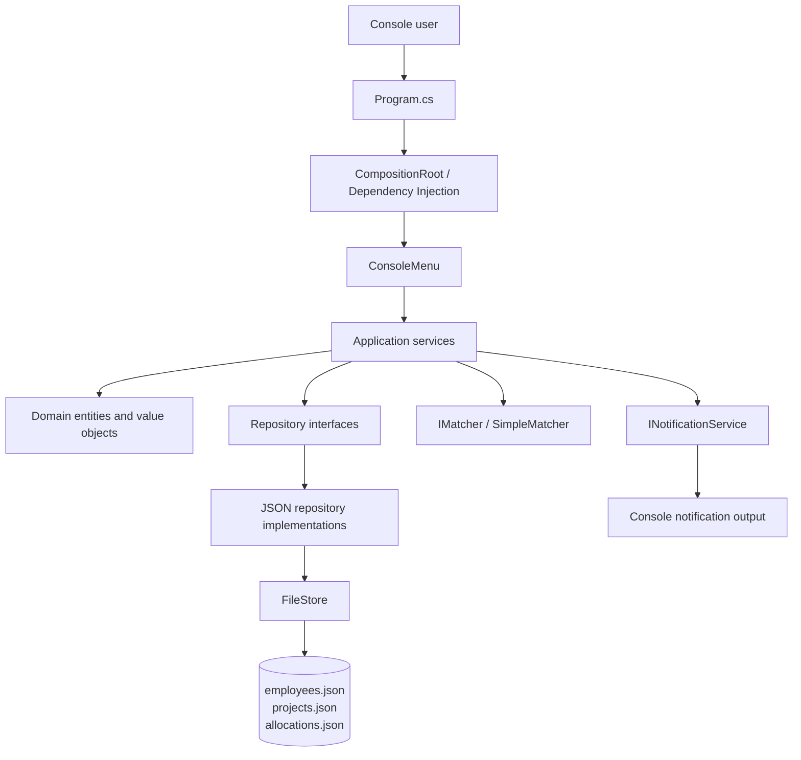
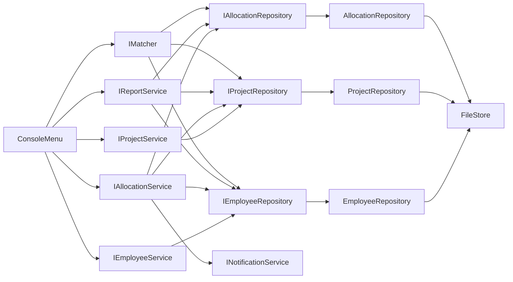
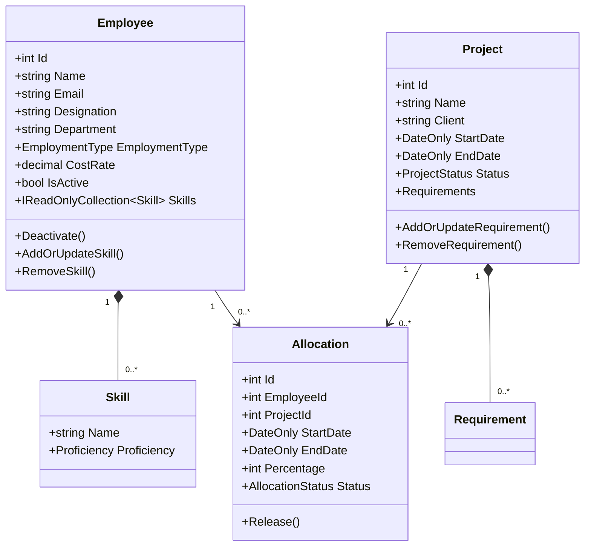
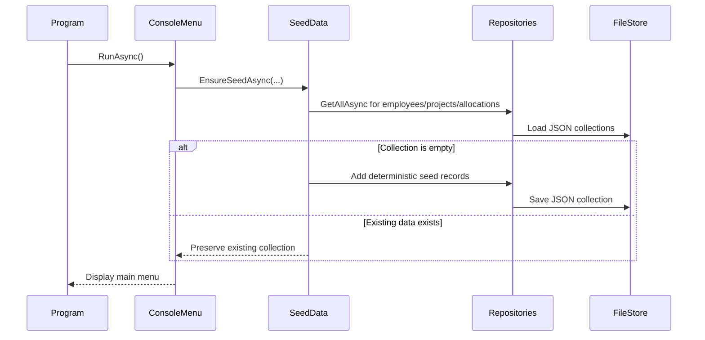
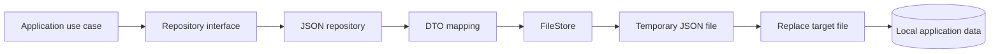

# TechNova RMS Design

## Scope and architectural style

TechNova RMS is a .NET 10 console application for managing employees, projects, skills, allocations, matching, and utilization reports. It uses a pragmatic single-project Clean Architecture style: domain rules are kept independent of storage and console concerns, application services coordinate use cases, and infrastructure implements persistence and notifications.

The executable project is `TechNova.RMS.Console`. The test project is `TechNova.RMS.Tests` and references the executable project so the domain and application behavior can be tested without starting the console UI.

## Architecture diagram

Dependency direction is inward: the domain has no dependency on repositories, JSON, dependency injection, or the console. Application interfaces define the seams used by infrastructure and tests. `CompositionRoot` is the only place that selects concrete implementations for the running application.

## Project and folder responsibilities

| Area | Responsibility | Representative types |
| --- | --- | --- |
| `Program.cs` | Process entry point; builds the service provider and starts the menu. | Top-level program |
| `ConsoleMenu.cs` | Presents menus, validates basic input, invokes application services, and formats results. | `ConsoleMenu` |
| `Domain` | Enforces entity invariants and owns business state transitions. | `Employee`, `Project`, `Allocation`, `Skill`, `Proficiency` |
| `Application/Repositories` | Storage contracts consumed by application services. | `IEmployeeRepository`, `IProjectRepository`, `IAllocationRepository` |
| `Application/Services` | Use-case orchestration for employee, project, allocation, reporting, and notification behavior. | `EmployeeService`, `ProjectService`, `AllocationService`, `ReportService` |
| `Application/Services/Matching` | Candidate matching contract, scoring algorithm, and explanation model. | `IMatcher`, `SimpleMatcher`, `MatchResult` |
| `Infrastructure/Json` | JSON persistence, DTO conversion, file location, and legacy identifier migration. | `*Repository`, `FileStore` |
| `Infrastructure/Notifications` | Console implementation of allocation notifications. | `ConsoleNotificationService` |
| `SeedData.cs` | Adds initial employees, projects, requirements, and allocations when collections are empty. | `SeedData` |
| `TechNova.RMS.Tests` | Automated tests for domain rules, allocation constraints, matching, and reports. | `RmsTests` |

## Runtime dependencies

The repositories and services are registered as singletons. Repository operations load and save complete JSON collections; there is no database, web API, background worker, or external service dependency.

## Domain model

### Core invariants

- Employee, project, and allocation identifiers must be positive.
- Required text fields cannot be blank; skill and requirement names are matched case-insensitively.
- Employee cost rates are positive and proficiency values are restricted to the domain's 1–5 range.
- Employee deactivation prevents new allocations and excludes the employee from matching and active-employee reports.
- Project and allocation end dates cannot precede their start dates.
- An allocation percentage must be between 1 and 100.
- An allocation must fit inside the selected project's dates.
- Overlapping active allocations for one employee cannot exceed 100% on any date.
- Releasing an allocation is idempotent; released allocations do not consume capacity.

## Main data flows

### Startup and seeding

Each collection is seeded independently when empty. Projects and allocations use the current UTC date to calculate relative date ranges, so the initial dates move forward when data is first created. Once a JSON file contains data, startup does not merge or overwrite it.

### Allocation creation

1. `ConsoleMenu` reads employee, project, dates, and percentage.
2. `AllocationService` verifies that the employee and project exist and that the employee is active.
3. The service verifies that the allocation dates are inside the project dates.
4. Existing active allocations are checked for every date in the requested inclusive range; capacity above 100% is rejected.
5. A new domain `Allocation` receives the next numeric identifier and is persisted through `IAllocationRepository`.
6. `INotificationService` writes a creation notification to the console.

### Matching and reporting

`SimpleMatcher` validates the project and requested date range, excludes inactive or fully allocated employees, then scores candidates by required-skill matches and a cost-rate penalty. Results include matched and missing skills and are ordered by score and employee name. `ReportService` calculates bench, project staffing, and department utilization views from employees, projects, and active allocations.

## Persistence and data flow

JSON files are stored under `%LOCALAPPDATA%/TechNova.RMS` by default. Set `TECHNOVA_RMS_DATA_DIR` to use another directory, which is useful for isolated runs and tests. Repositories map domain objects to DTOs to avoid serializing private collections or domain behavior directly.

`FileStore` creates the directory on demand, writes indented JSON through a temporary file, and replaces the previous file. Reads are case-insensitive and include a migration path for older files containing GUID identifiers. A malformed or unsupported file results in an `InvalidOperationException` that identifies the storage path.

## Testing strategy

The tests use in-memory repository doubles and directly exercise services and domain objects. The current suite covers invalid allocation values, inactive employees, overlapping capacity, project-date boundaries, idempotent release notifications, matching explanations, fully allocated exclusions, bench reporting, and department utilization. This keeps business rules testable without depending on the user's local data directory.

## Architecture Decision Records

### ADR-001: Use a pragmatic single-project Clean Architecture layout

- **Context:** The assignment needs clear separation between domain rules, application use cases, infrastructure, and console presentation without introducing multiple production projects.
- **Decision:** Keep one executable project, but separate `Domain`, `Application`, `Infrastructure`, and UI code by folders and interfaces.
- **Alternatives considered:** A flat console project; multiple class-library projects; a full hexagonal framework.
- **Consequences:** The code remains easy to build and teach while dependencies are explicit. Folder boundaries are conventions rather than compiler-enforced assembly boundaries.

### ADR-002: Use dependency injection at the composition root

- **Context:** Services need repositories and notification implementations, while tests need replaceable in-memory dependencies.
- **Decision:** Register interfaces and concrete implementations in `CompositionRoot` using `Microsoft.Extensions.DependencyInjection`; resolve only the console menu from `Program.cs`.
- **Alternatives considered:** Direct `new` calls throughout the UI; a service locator; a third-party IoC container.
- **Consequences:** Runtime wiring is centralized and tests can construct services with fakes. The application has a dependency on the Microsoft DI package and singleton lifetime behavior must remain appropriate for the process.

### ADR-003: Persist data as JSON files through repository interfaces

- **Context:** The first version needs durable local storage without database setup or network infrastructure.
- **Decision:** Implement `IEmployeeRepository`, `IProjectRepository`, and `IAllocationRepository` with System.Text.Json-backed repositories using `FileStore`.
- **Alternatives considered:** In-memory-only storage; SQLite; a remote database or HTTP API.
- **Consequences:** The application is portable and simple to run, and storage can later be replaced behind interfaces. Collection-level file reads and writes do not provide database transactions or multi-process concurrency guarantees.

### ADR-004: Keep domain invariants inside domain objects and use cases

- **Context:** Invalid identifiers, dates, percentages, and lifecycle transitions should not depend on console input validation.
- **Decision:** Domain constructors and methods validate local invariants; application services validate cross-entity rules such as project boundaries and employee capacity.
- **Alternatives considered:** Validation only in `ConsoleMenu`; validation only in repositories; an external validation framework.
- **Consequences:** Business behavior is reusable and testable from non-console callers. Some validation is intentionally duplicated at input and domain boundaries for clear user feedback and safety.

### ADR-005: Calculate allocation capacity over each calendar date

- **Context:** An employee may have overlapping allocations with different date ranges, and total utilization must never exceed 100% on an individual day.
- **Decision:** `AllocationService` and `SimpleMatcher` inspect the inclusive date range and sum overlapping active allocation percentages per day.
- **Alternatives considered:** Compare only whole-range totals; average utilization across the range; use a calendar/time-sheet subsystem.
- **Consequences:** The rule is precise and easy to reason about for the current scale. It is an O(days × allocations) calculation and would need optimization or a calendar index for large datasets.

### ADR-006: Use deterministic seed records with non-destructive startup behavior

- **Context:** A fresh demonstration should be useful immediately, but an existing user's changes must not be overwritten on every launch.
- **Decision:** Seed employees, projects, and allocations only when the corresponding repository collection is empty; use fixed identities and relative project dates based on UTC today.
- **Alternatives considered:** Always reset demo data; seed nothing; use random generated data.
- **Consequences:** Fresh runs are predictable and repeatable, while existing data is preserved. Relative dates change with the first run date, and there is no built-in reset command.

### ADR-007: Report and matching results are read-only projections

- **Context:** Matching and reports need combined views across multiple repositories but should not mutate business entities.
- **Decision:** Return `MatchResult`, `BenchEntry`, `ProjectStaffingEntry`, and `DepartmentUtilizationEntry` projection records from application services.
- **Alternatives considered:** Return domain entities with presentation logic; persist report snapshots; calculate reports directly in the console menu.
- **Consequences:** Presentation receives focused, testable results and domain state remains protected. Projections are calculated on demand and are not historical reporting snapshots.
